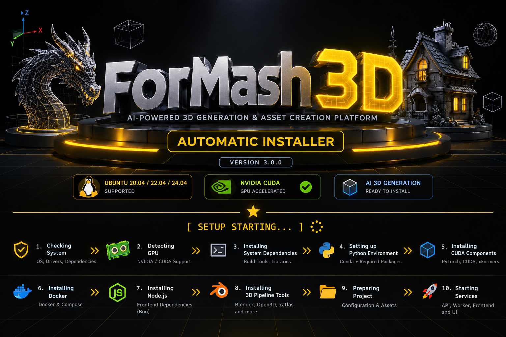

<!-- ===================== HERO BANNER ===================== -->

<p align="center">
   
 </p>

<h1 align="center">
  ForMash3D — Third-Party 3D AI Runtime
</h1>

<p align="center">
  <strong>Curated 3D AI model sources and runtime dependencies used by ForMash3D</strong><br>
  Neural 3D Generation • Shape Processing • UV • Rigging • Part Processing • Mesh Editing
</p>

<p align="center">
  
  
  
  
  
  
</p>

---

## Overview

`ForMash3D-ThirdParty` is the dedicated third-party source repository used by the **ForMash3D backend**.

It contains the external 3D AI model source trees required by the backend runtime. The repository is intentionally separated from the main ForMash3D application so that the main application repository stays lightweight while the complete 3D model stack remains available as one versioned dependency bundle.

This repository is **not a standalone application**. It is consumed by ForMash3D through:

```text
ForMash3D/
└── backend/
    └── thirdparty/
        ├── FastMesh/
        ├── hunyuan3d-shape-v2-1/
        ├── hunyuan3d-paint-v2-1/
        ├── hunyuan3d-dit-v2-mini-turbo/
        ├── PartField/
        ├── PartPacker/
        ├── PartUV/
        ├── TRELLIS/
        ├── TRELLIS.2/
        ├── TripoSF/
        ├── TripoSG/
        ├── TripoSR/
        ├── UltraShape/
        ├── UniRig/
        ├── VoxHammer/
        ├── ardy/
        └── wheels/
```

The main backend consumes this repository as a **Git submodule** at `backend/thirdparty`. The submodule is initialized and updated via the main repository's setup script. Each model integration is independently managed and can be updated separately.

---

## ForMash3D Runtime Integration Notes

The main application pins this repository as a Git submodule. Its Hunyuan3D-Paint integration now bounds raster interpolation and UV attribute extraction in row chunks to reduce large temporary CUDA allocations. When the main scheduler supplies a multi-GPU resource plan, the paint integration places mesh rendering / super-resolution on the first reserved device and multiview diffusion on the second; the renderer honors the configured CUDA device. These placements are component-level placement, not tensor-parallel inference.

GPU memory requirements remain dependent on mesh complexity, texture resolution, checkpoints, and other workloads. The upstream model's real peak memory and end-to-end quality must be verified on the target hardware; CPU/static tests do not establish GPU inference success.

# Why This Repository Exists

ForMash3D integrates multiple research-grade 3D systems with different build requirements, CUDA extensions, Python dependencies, model layouts, and inference contracts.

Keeping all of those source trees directly inside the main application repository would:

- increase the main repository size
- increase Git history size
- mix application code with external model code
- make model-source versioning harder to manage
- complicate backend cloning and deployment
- make model revisions harder to pin as a single runtime bundle

This repository solves that by providing one dedicated source bundle:

```text
Main ForMash3D Repo
        │
        └── backend/thirdparty
                 │
                 ▼
        ForMash3D-ThirdParty
                 │
       ┌─────────┼─────────┐
       ▼         ▼         ▼
    TRELLIS   Hunyuan3D   UniRig
       │         │         │
       └─────────┼─────────┘
                 ▼
           CUDA / PyTorch
                 ▼
              NVIDIA GPU
```

# Model Catalog

| Directory | Source Repository | Primary Role |
|---|---|---|
| `hunyuan3d-shape-v2-1/` | https://github.com/Tencent-Hunyuan/Hunyuan3D-2.1 | 3.3B shape generation |
| `hunyuan3d-paint-v2-1/` | https://github.com/Tencent-Hunyuan/Hunyuan3D-2.1 | 2B PBR texture generation |
| `hunyuan3d-dit-v2-mini-turbo/` | https://github.com/Tencent-Hunyuan/Hunyuan3D-2 | 0.6B low-VRAM shape generation |
| `TRELLIS/` | https://github.com/FishWoWater/TRELLIS | Structured 3D generation and mesh reconstruction |
| `TRELLIS.2/` | https://github.com/FishWoWater/TRELLIS.2 | Higher-quality 3D generation / downstream processing |
| `FastMesh/` | https://github.com/FishWoWater/FastMesh | Fast mesh processing / reconstruction |
| `UniRig/` | https://github.com/FishWoWater/UniRig | Automatic rigging and animation preparation |
| `ardy/` | https://github.com/NVlabs/ardy | Autoregressive diffusion for interactive motion generation |
| `PartUV/` | https://github.com/FishWoWater/PartUV | UV and surface processing |
| `Paint3D/` | Unknown | To be determined |
| `Pixal3D/` | Unknown | To be determined |
| `Unique3D/` | Unknown | To be determined |

---

# Source Strategy

This repository intentionally contains a **mixed source strategy**.

## Integration forks

Several model directories use FishWoWater-maintained repositories:

```text
FishWoWater/TRELLIS
FishWoWater/TRELLIS.2
Tencent-Hunyuan/Hunyuan3D-2.1
Tencent-Hunyuan/Hunyuan3D-2
FishWoWater/UniRig
FishWoWater/FastMesh
FishWoWater/PartUV
FishWoWater/VoxHammer
```

These repositories are used by the 3DAIGC-oriented integration stack and may contain API-ready changes, compatibility changes, inference integration, configuration changes, or other adaptations required by the backend.

They should **not** be casually replaced with unrelated upstream revisions.

## Upstream repositories

Some model directories track upstream projects directly:

```text
nv-tlabs/PartField
NVlabs/PartPacker
PKU-YuanGroup/UltraShape-1.0
VAST-AI-Research/TripoSF
VAST-AI-Research/TripoSG
VAST-AI-Research/TripoSR
NVlabs/ardy
```

The exact repository revision consumed by ForMash3D is determined by the version stored in this dependency bundle.

---

# Repository Structure

```text
ForMash3D-ThirdParty/
│
├── FastMesh/
├── hunyuan3d-shape-v2-1/
├── hunyuan3d-paint-v2-1/
├── hunyuan3d-dit-v2-mini-turbo/
├── PartField/
├── PartPacker/
├── PartUV/
├── TRELLIS/
├── TRELLIS.2/
├── TripoSF/
├── TripoSG/
├── TripoSR/
├── UltraShape/
├── UniRig/
├── VoxHammer/
├── ardy/
└── wheels/
```

Each model integration is independently managed. The main ForMash3D backend references `backend/thirdparty/` as a Git submodule.

---

# Integration With ForMash3D

The main ForMash3D backend references this repository as a **Git submodule** at `backend/thirdparty/`. The submodule is initialized and updated via the main repository's setup script.

The resulting application layout is:

```text
ForMash3D/
├── frontend / app code
├── backend/
│   ├── app/
│   ├── scripts/
│   ├── runtime/
│   └── thirdparty/        <-- this repository (Git submodule)
└── setup.sh
```# Runtime Architecture

```text
                         ForMash3D
                             │
                             ▼
                      FastAPI Backend
                             │
                             ▼
                   Model Integration Layer
                             │
                             ▼
                    backend/thirdparty
                             │
          ┌──────────────────┼──────────────────┐
          ▼                  ▼                  ▼
       TRELLIS          Hunyuan3D           UniRig
          │                  │                  │
          └──────────────────┼──────────────────┘
                             ▼
                       PyTorch / CUDA
                             │
                             ▼
                         NVIDIA GPU
```

ForMash3D remains responsible for application orchestration, API contracts, job execution, storage, runtime state, model selection, telemetry, and user-facing workflows.

This repository provides the external model source trees required by that runtime.

---

## ARDY CPU-mode contract

The ForMash3D ARDY adapter explicitly loads both the motion model and its local LLM2Vec text encoder on CPU. The vendored LLM2Vec encoder must keep an explicit non-CUDA device in its single-process path, even when CUDA devices are visible to the host; multi-process text encoding is only used for CUDA requests.

# CUDA / PyTorch Baseline

The current 3DAIGC-oriented integration baseline is:

| Component | Baseline |
|---|---|
| CUDA | **12.4** |
| PyTorch | **2.6.0** |
| TorchVision | **0.21.0** |
| TorchAudio | **2.6.0** |
| PyTorch CUDA build | **cu124** |
| Python | **3.10** |
| Base Linux environment | **Ubuntu 20.04** |

These versions should be treated as the **integration baseline**, not as a promise that every individual model uses an identical internal environment.

Several model packages compile native extensions, so changing CUDA, PyTorch, Python, or compiler versions can require rebuilding affected components.

---

# Native Build Dependencies

Depending on the model, the runtime can involve:

- CUDA kernels
- C/C++ extensions
- PyTorch custom operators
- differentiable rasterizers
- voxel-processing extensions
- mesh-processing libraries
- Kaolin
- FlashAttention
- PyTorch Geometric packages
- custom rasterizers
- Blender-related native tooling
- CMake / Ninja build systems

This is why the repository should be treated as a **versioned dependency bundle** rather than a collection of unrelated folders.

## Prebuilt Wheelhouse (`wheels/`)

To eliminate hours of complex, error-prone C++/CUDA compilation during setup, this repository ships precompiled `.whl` binaries in the `wheels/` directory (tracked via **Git LFS**).

### Community & External Project Use

> [!TIP]
> **Open for Community Use:**
> Anyone is welcome to use these prebuilt wheels in their own 3D AI, PyTorch, or computer graphics projects! If you are building tools with TRELLIS, Hunyuan3D, TripoSR, 3D Gaussian Splatting, or custom CUDA pipelines, feel free to download or vendor these binaries to skip manual compilation.

#### Included Wheels

| Package | Version | Primary Role / Used By |
|---|---|---|
| `flash_attn` | `2.7.4.post1` | FlashAttention-2 (PyTorch 2.6 + CUDA 12.4, CXX11 ABI False) |
| `spconv_cu124` | `2.3.8` | Spatial Sparse Convolution for CUDA 12.4 |
| `diff_gaussian_rasterization` | `0.0.0` | 3D Gaussian Splatting rasterizer |
| `nvdiffrast` | `0.4.0` | NVIDIA differentiable rasterization library |
| `nvdiffrec_render` | `0.0.0` | NVIDIA DiffRec render kernels |
| `cubvh` | `0.1.2` | CUDA Bounding Volume Hierarchy acceleration |
| `cumesh` | `0.0.1` | CUDA mesh data structures and operations |
| `diso` | `0.1.4` | Differentiable Isosurfacing |
| `torch_scatter` | `2.1.2` | PyTorch scatter operations |
| `torchmcubes` | `0.1.0` | Marching cubes GPU implementation (rebuilt for PyTorch 2.6.0+cu124, CUDA 12.4, CXX11 ABI False) |
| `fpsample` | `0.3.3` | Farthest Point Sampling |
| `o_voxel` | `0.0.1` | Octree voxel operations (TRELLIS.2) |
| `custom_rasterizer` | `0.1` | Custom rasterization kernels |
| `hy3d_mesh_inpaint_processor` | `0.1.0` | Hunyuan3D mesh inpainting extension |

#### How to Use These Wheels in Your Project

1. **Clone with Git LFS enabled** (mandatory):
   ```bash
   git lfs install
   git clone https://github.com/Silentzx2/ForMash3D-ThirdParty.git
   cd ForMash3D-ThirdParty/wheels
   ```

2. **Install all wheels into your Python 3.10 environment**:
   ```bash
   pip install *.whl
   ```
   *Or install a specific wheel individually:*
   ```bash
   pip install flash_attn-2.7.4.post1+cu12torch2.6cxx11abiFALSE-cp310-cp310-linux_x86_64.whl
   ```

---

### ⚠️ Critical Compatibility Warnings

> [!WARNING]
> **Strict Platform & Toolchain Requirements:**
> These binary wheels are compiled for a specific execution matrix and **will NOT work** if your environment differs:
> - **Operating System:** Linux x86_64 only (glibc / manylinux). Windows and macOS are **not supported**.
> - **Python Version:** **Python 3.10** (`cp310`). They will fail to install on Python 3.11, 3.12, or 3.9.
> - **PyTorch & CUDA:** **PyTorch 2.6.0+cu124** with **CUDA 12.4 runtime**. Mismatched PyTorch versions will throw `undefined symbol` or `ABI mismatch` errors on import.
> - **PyTorch CXX11 ABI:** Compiled with `_GLIBCXX_USE_CXX11_ABI=0` (PyTorch default binary ABI).
> - **NVIDIA GPU Architectures:** Compute Capability 7.5, 8.0, 8.6, 8.9, 9.0 (Turing, Ampere, Ada Lovelace, Hopper).

> [!CAUTION]
> **Git LFS Requirement:**
> The wheels are stored with Git LFS. If you download via standard `git clone` or a zip download without `git-lfs` initialized, you will only receive small ~130-byte text pointer files instead of real `.whl` binaries, causing `pip install` to fail with `not a valid wheel filename` or `bad zipfile`. Always verify `git lfs pull` completed successfully before running `pip install`.

---

# Model Weights

This repository is primarily for **model source code and integration code**.

Large pretrained weights should normally be stored or downloaded separately through the ForMash3D runtime/model-storage mechanism.

Common model-weight formats include:

```text
.safetensors
.ckpt
.pth
.pt
.bin
```

Avoid committing large model checkpoints to the Git source repository unless there is a specific deployment reason to do so.

---

# Build and Installation Requirements

Depending on the target model, the environment may require:

- NVIDIA GPU
- Compatible NVIDIA driver
- CUDA toolkit/runtime
- GCC/G++
- CMake
- Ninja
- Python
- PyTorch
- Git
- Conda / virtualenv / uv
- Blender
- Model-specific native dependencies

Not every model has the same VRAM, compiler, or dependency requirements.

For reproducible builds, install the model using the dependency instructions associated with its directory and the ForMash3D backend's runtime configuration.

---

# Recommended Installation Flow

```text
1. Clone ForMash3D
        │
        ▼
2. Initialize backend/thirdparty
        │
        ▼
3. ForMash3D-ThirdParty is checked out
        │
        ▼
4. Prepare model-specific Python environments
        │
        ▼
5. Install PyTorch / CUDA-native dependencies
        │
        ▼
6. Build required native extensions
        │
        ▼
7. Download model weights
        │
        ▼
8. Start backend / worker runtime
        │
        ▼
9. Execute 3D generation and processing
```

---

# Model Runtime Roles

## TRELLIS

Used for neural 3D generation and structured mesh reconstruction. The ForMash3D integration uses the FishWoWater-maintained repository rather than assuming a random upstream revision.

## TRELLIS.2

Used for newer/high-quality 3D generation workflows and as part of the broader dependency stack used by the 3D runtime.

## Hunyuan3D-Shape-v2-1

Provides 3.3B shape-generation capabilities used in ForMash3D's 3D generation workflows. Source: `backend/thirdparty/hunyuan3d-shape-v2-1/`.

## Hunyuan3D-Paint-v2-1

Provides 2B PBR texture generation capabilities used in ForMash3D's texture workflows. Source: `backend/thirdparty/hunyuan3d-paint-v2-1/`.

## Hunyuan3D-DiT-v2-mini-Turbo

Provides 0.6B low-VRAM shape-generation capabilities for faster, lower-resource inference. Source: `backend/thirdparty/hunyuan3d-dit-v2-mini-turbo/`.

## UniRig

Provides automated rigging-related functionality and supports animation-oriented post-processing workflows.

## FastMesh

Provides fast mesh-oriented processing/reconstruction functionality.

## PartUV

Provides UV and surface-processing functionality used by downstream 3D asset workflows.

## PartField

Provides part-aware 3D understanding and representation functionality.

## PartPacker

Provides part-level geometric processing and packing workflows.

## UltraShape

Provides shape refinement/reconstruction capabilities.

## VoxHammer

Provides 3D editing and voxel/mesh processing capabilities used by the broader editing pipeline.

## TripoSR

Provides fast feedforward single-image 3D reconstruction with GPU-accelerated marching cubes isosurface extraction.

## TripoSG

Provides rectified flow image-to-3D shape generation with DiT and Dinov2 image encoder conditioning.

## TripoSF

Provides high-resolution sparse voxel 3D shape generation.

## ardy

Provides autoregressive diffusion for interactive motion generation.

---

# Versioning Policy

Treat this repository as a versioned runtime dependency of ForMash3D.

Do not randomly update model sources.

A model update can affect:

- CUDA compilation
- PyTorch compatibility
- custom CUDA extensions
- Python APIs
- inference APIs
- checkpoint loading
- output formats
- VRAM usage
- performance
- backend adapters
- generated asset compatibility

When a known-good state is established, update the ForMash3D backend's `backend/thirdparty/` directory to point to the tested commit.

---

# Updating the Repository

Before making changes:

```bash
git status
git log --oneline -10
```

After an intentional source update:

```bash
git add .
git commit -m "Update third-party model sources"
git push
```

Then update the ForMash3D backend repository so its `backend/thirdparty/` directory reflects the tested state.

---

# Troubleshooting

## Thirdparty directory is empty or incomplete

Populate the directory by cloning the required upstream repositories directly:

```bash
cd backend/thirdparty
git clone --depth 1 https://github.com/Tencent-Hunyuan/Hunyuan3D-2.1.git hunyuan3d-shape-v2-1
git clone --depth 1 https://github.com/Tencent-Hunyuan/Hunyuan3D-2.1.git hunyuan3d-paint-v2-1
git clone --depth 1 https://github.com/Tencent-Hunyuan/Hunyuan3D-2.git hunyuan3d-dit-v2-mini-turbo
rm -rf hunyuan3d-shape-v2-1/.git hunyuan3d-paint-v2-1/.git hunyuan3d-dit-v2-mini-turbo/.git
```

## Check the configured directory

```bash
ls -1 ./backend/thirdparty
```

## Inspect the directory structure

```bash
find ./backend/thirdparty -maxdepth 1 -type d | sort
```

## Check NVIDIA driver

```bash
nvidia-smi
```

## Check PyTorch CUDA

```bash
python -c "import torch; print('PyTorch:', torch.__version__); print('CUDA:', torch.version.cuda); print('CUDA available:', torch.cuda.is_available())"
```

## CUDA extension build failure

Check these together before changing versions:

```text
Python version
PyTorch version
CUDA toolkit/runtime
NVIDIA driver
GPU architecture
Compiler version
Native extension version
```

Rebuild only the affected native component when possible.

## VRAM / out-of-memory problems

Different model families have different memory footprints.

Prefer sequential heavyweight-model execution when the backend scheduler supports it:

```text
Load Model A
    ↓
Run inference
    ↓
Release model / VRAM
    ↓
Load Model B
    ↓
Run inference
```

---

# Storage

The Git source tree is only part of the complete runtime footprint.

Additional storage can be required for:

- Python environments
- PyTorch packages
- CUDA extensions
- model weights
- Hugging Face caches
- Blender assets
- build directories
- compiled binaries
- generated outputs
- temporary inference data

A full production installation can therefore be substantially larger than this repository by itself.

---

# Security and Secrets

Never commit runtime credentials or secrets such as:

```text
.env
API keys
Hugging Face tokens
SSH keys
cloud credentials
private access tokens
database passwords
```

Use environment variables or the ForMash3D runtime configuration system instead.

---

# Maintenance Guidelines

When modifying a model directory:

1. Preserve the expected directory structure.
2. Preserve model-specific dependency assumptions.
3. Avoid unnecessary rewrites of research code.
4. Keep CUDA/native build requirements explicit.
5. Validate imports after native dependency changes.
6. Run a real inference/smoke test after significant dependency changes.
7. Update the ForMash3D backend's `backend/thirdparty/` directory after validation.

---

# Relationship to ForMash3D

```text
ForMash3D
│
├── frontend / product UI
│
├── backend
│   ├── FastAPI
│   ├── workers
│   ├── runtime manager
│   ├── model adapters
│   └── thirdparty (Git submodule) ──────────► ForMash3D-ThirdParty
│
└── setup / deployment scripts
```

The separation provides a clear ownership boundary:

**ForMash3D**

- Application UI
- API contracts
- Jobs and orchestration
- Runtime management
- Storage
- Telemetry
- Asset delivery

**ForMash3D-ThirdParty**

- External 3D AI model source trees
- Model-specific integration source
- Model-specific build configuration
- Native extension source trees required by those models

---

# Current Repository

**Repository:** `ForMash3D-ThirdParty`

**GitHub:**

```text
https://github.com/Silentzx2/ForMash3D-ThirdParty
```

**Primary consumer:** ForMash3D backend

**Integration path:**

```text
ForMash3D/backend/thirdparty
```

**Delivery mechanism:** Git submodule

**Runtime family:** NVIDIA CUDA + PyTorch

**Model source strategy:** Mixed upstream repositories and API/integration forks

**Weights:** Managed separately from source whenever possible

**Repository type:** Public dependency bundle

---

# Quick Commands

### Clone this repository directly

```bash
git clone https://github.com/Silentzx2/ForMash3D-ThirdParty.git
```

### Update this repository

```bash
git pull
```

### Verify model directories

```bash
ls -1 ./backend/thirdparty
```

Expected directories:

```text
FastMesh
hunyuan3d-dit-v2-mini-turbo
hunyuan3d-paint-v2-1
hunyuan3d-shape-v2-1
PartField
PartPacker
PartUV
TRELLIS
TRELLIS.2
TripoSF
TripoSG
TripoSR
UltraShape
UniRig
VoxHammer
ardy
wheels
```

---

<p align="center">
  <strong>ForMash3D — 3D AI Runtime Stack</strong><br>
  <sub>One backend. One dependency bundle. Reproducible model environments.</sub>
</p>


# Runtime Path Resolution Contract

Hunyuan3D-Paint resolves checkpoint sources explicitly. A blank source uses the
documented default Hugging Face repository. An existing local directory is used
as-is (or its `hunyuan3d-paintpbr-v2-1` child when present) and must contain
`model_index.json`. A missing absolute path, incomplete local DINOv2 checkpoint,
or invalid local model layout fails with an actionable error; it must not silently
switch to a different remote model. A Hugging Face repository ID such as
`tencent/Hunyuan3D-2.1` remains a supported explicit source.

Dependency-light resolver regression tests live in
`tests/test_runtime_path_utils.py` and can be run with:

```bash
python -m pytest -q tests/test_runtime_path_utils.py
```
